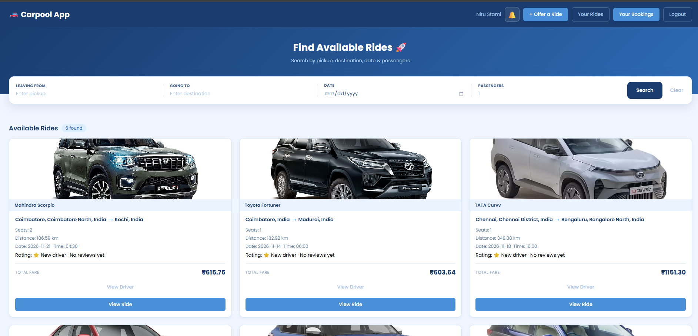
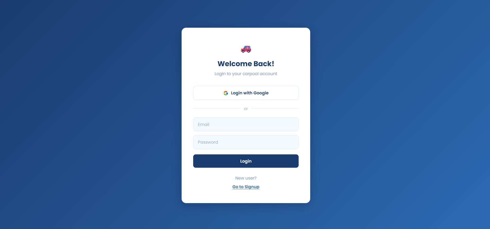
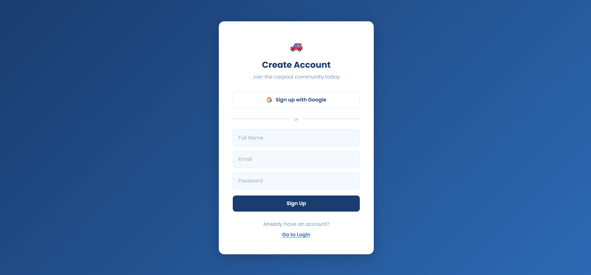
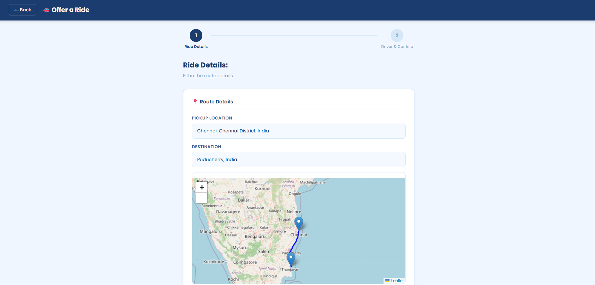
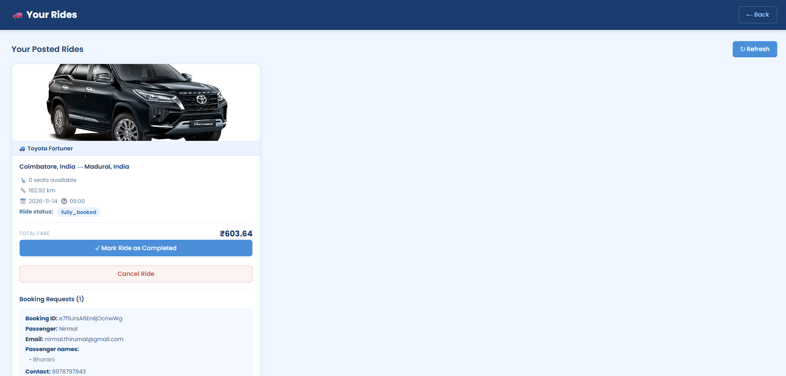
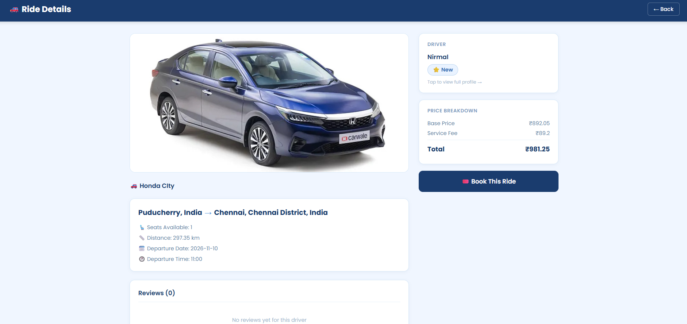
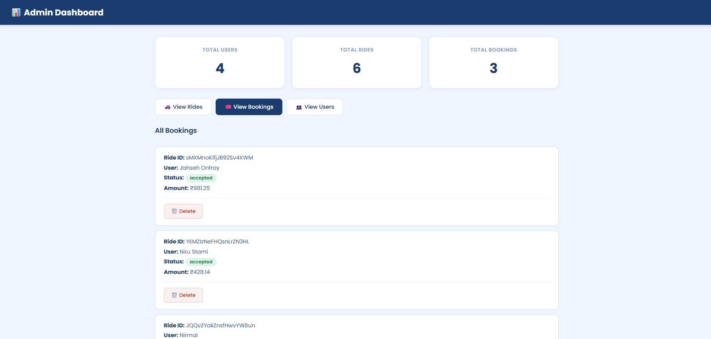

# Carpooling Web Application

A full-stack carpooling platform that connects drivers and passengers, making shared travel more convenient, accessible, and affordable.

## Project Overview

The Carpooling Web Application is designed to help users find and share rides between locations. Drivers can publish available rides, while passengers can explore available journeys and submit booking requests.

The platform provides user authentication, ride management, booking management, route visualization, real-time data updates through Firebase, and communication features.

## Key Features

- **User Authentication:** Register and log in using email/password or Google authentication.
- **Ride Publishing:** Drivers can publish rides with pickup locations, destinations, departure dates, available seats, and pricing.
- **Location Search:** Search for pickup and destination locations with location suggestions.
- **Route Visualization:** Display driving routes using GraphHopper and Leaflet maps.
- **Distance and Fare Calculation:** Calculate driving distance and ride pricing.
- **Ride Discovery:** Browse and explore available rides.
- **Ride Booking:** Submit booking requests with passenger details, contact information, luggage preferences, and payment method.
- **Booking Management:** View and manage passenger bookings and driver booking requests.
- **Notifications:** Notify users about relevant booking activities.
- **Communication:** Chat functionality for ride-related communication.
- **Driver Profiles:** View driver information and ride-related details.
- **Ratings and Reviews:** Provide feedback after rides.
- **Admin Dashboard:** Administrative interface for managing platform activities.
- **Image Uploads:** Upload images using Cloudinary.

## Technology Stack

| Category | Technologies |
|---|---|
| Frontend | React.js, Vite, JavaScript |
| Styling | CSS3 |
| Backend | Node.js, Express.js |
| Database | Firebase Firestore |
| Authentication | Firebase Authentication |
| Backend Authentication | Firebase Admin SDK |
| Maps | Leaflet, React Leaflet |
| Location Search | OpenCage API |
| Route and Distance | GraphHopper API |
| Image Storage | Cloudinary |
| HTTP Requests | Axios, Fetch API |
| Payment-related Functionality | Cash and online payment options; verify gateway configuration before production use |
| Version Control | Git and GitHub |

## Project Architecture

The application follows a frontend-backend architecture.

```text
Carpooling-Web-Application/
│
├── carpool-frontend/
│   ├── public/
│   │   └── images/
│   ├── src/
│   │   ├── components/
│   │   ├── context/
│   │   ├── firebase/
│   │   ├── pages/
│   │   ├── services/
│   │   └── styles/
│   ├── package.json
│   └── vite.config.js
│
├── carpool-backend/
│   ├── config/
│   ├── middleware/
│   ├── routes/
│   ├── package.json
│   └── server.js
│
├── docs/
│   └── screenshots/
│       ├── homepage.png
│       ├── login.png
│       ├── signup.png
│       ├── add-ride.png
│       ├── ride-details.png
│       ├── booking.png
│       └── admin-dashboard.png
│
├── .gitignore
└── README.md
```

### Architecture Overview

- **Frontend:** React handles the user interface, navigation, authentication flows, ride listings, booking pages, and maps.
- **Backend:** Express.js provides REST API endpoints for ride operations, bookings, authentication-related operations, administration, and map services.
- **Firebase:** Firebase Authentication manages user sign-in, while Firestore stores application data.
- **Maps and Location Services:** OpenCage provides location suggestions, GraphHopper calculates driving routes and distances, and Leaflet displays routes on interactive maps.
- **Cloudinary:** Handles image uploads.

## Installation and Setup

Follow these steps to run the application locally.

### Prerequisites

Install the following before starting:

- [Node.js](https://nodejs.org/)
- npm (included with Node.js)
- [Git](https://git-scm.com/)
- A Firebase project
- OpenCage API key
- GraphHopper API key
- Cloudinary account

### 1. Clone the Repository

```bash
git clone https://github.com/NirmalThirumal/Carpooling-Web-Application.git
```

Navigate into the project:

```bash
cd Carpooling-Web-Application
```

### 2. Configure the Backend

Navigate to the backend folder:

```bash
cd carpool-backend
```

Install dependencies:

```bash
npm install
```

Create a `.env` file inside `carpool-backend/`:

```env
OPENCAGE_API_KEY=your_opencage_api_key
GRAPHHOPPER_API_KEY=your_graphhopper_api_key
GOOGLE_APPLICATION_CREDENTIALS=path_to_your_firebase_service_account.json
```

Configure Firebase Admin SDK credentials using a Firebase service account JSON file. Keep this file private and never upload it to GitHub.

For local development on Windows, `GOOGLE_APPLICATION_CREDENTIALS` should point to the absolute path of your service account JSON file.

Example:

```env
GOOGLE_APPLICATION_CREDENTIALS=D:/firebase-credentials/serviceAccountKey.json
```

Start the backend:

```bash
npm run dev
```

The backend runs at:

```text
http://localhost:5000
```

### 3. Configure the Frontend

Open another terminal and navigate to the frontend folder:

```bash
cd carpool-frontend
```

Install dependencies:

```bash
npm install
```

Create a `.env` file inside `carpool-frontend/`:

```env
VITE_API_BASE_URL=http://localhost:5000
```

Configure your Firebase client settings in:

```text
src/firebase/config.js
```

Configure your Cloudinary cloud name and upload preset in:

```text
src/services/cloudinary.js
```

Use your own Firebase and Cloudinary project configuration.

Start the frontend:

```bash
npm run dev
```

The Vite development server will display its local URL in the terminal, usually:

```text
http://localhost:5173
```

Open that URL in your browser.

## Environment Variables

### Backend

| Variable | Description |
|---|---|
| `OPENCAGE_API_KEY` | API key for location suggestions |
| `GRAPHHOPPER_API_KEY` | API key for route and distance calculations |
| `GOOGLE_APPLICATION_CREDENTIALS` | Path to Firebase Admin service account credentials |

### Frontend

| Variable | Description |
|---|---|
| `VITE_API_BASE_URL` | Backend API base URL |

**Important:** Never commit `.env` files, Firebase service account credentials, or private API keys to GitHub.

## Application Screenshots

The following screenshots showcase the main interfaces and features of the Carpooling Web Application.

### 1. Homepage

Displays available rides, search filters, vehicle information, routes, and fare details.



### 2. Login Page

Allows existing users to log in using email/password or Google authentication.



### 3. Signup Page

Allows new users to create an account using their name, email, and password or Google authentication.



### 4. Add Ride

Allows drivers to enter ride details, select pickup and destination locations, and view the route on an interactive map.



### 5. Ride Details

Displays vehicle information, driver details, available seats, journey distance, departure information, fare breakdown, and booking options.



### 6. Booking Management

Displays ride booking information and allows users to manage their booking-related activities.



### 7. Admin Dashboard

Provides an administrative interface to view platform statistics and manage rides, bookings, and users.



## Future Improvements

- Deploy the frontend and backend to production hosting.
- Improve application performance and accessibility.
- Strengthen API security and authorization.
- Enhance payment gateway integration.
- Add further ride discovery and user experience improvements.

## Author

**Nirmal T**

B.Tech Computer Science Engineering

GitHub: [NirmalThirumal](https://github.com/NirmalThirumal)

## Repository

[Carpooling Web Application](https://github.com/NirmalThirumal/Carpooling-Web-Application)

---

*Developed as a full-stack web application project.*