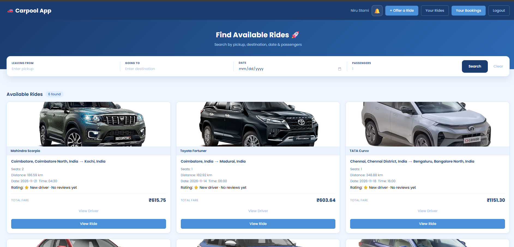
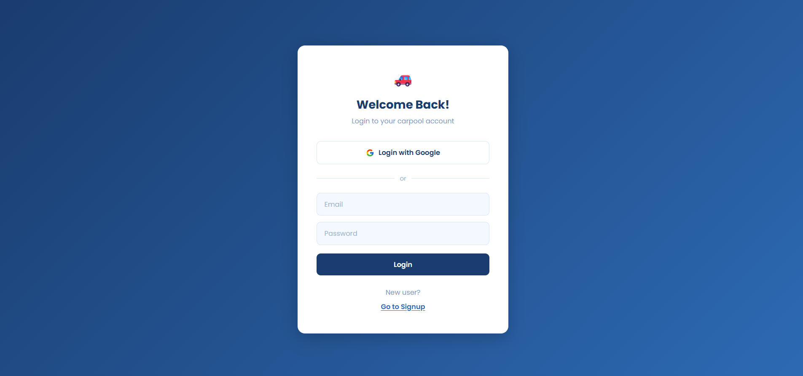
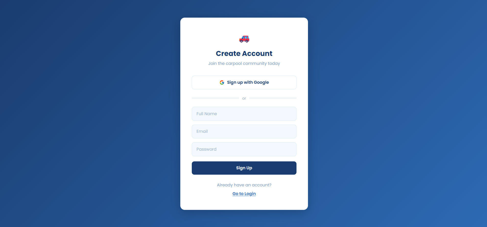
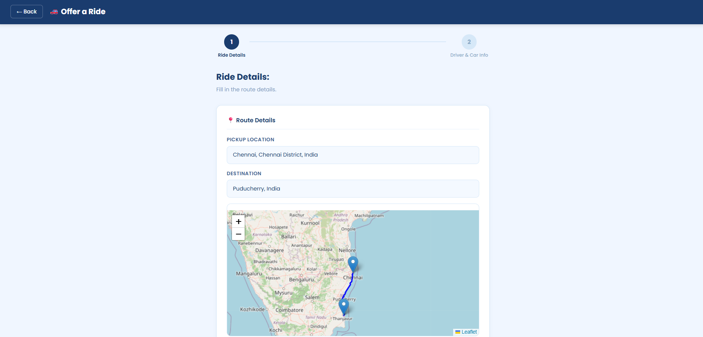
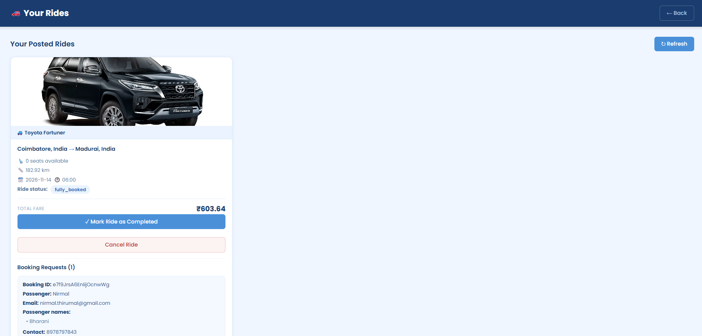
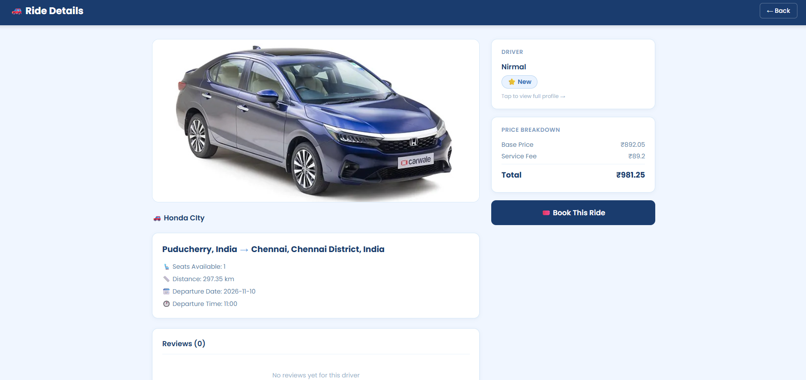
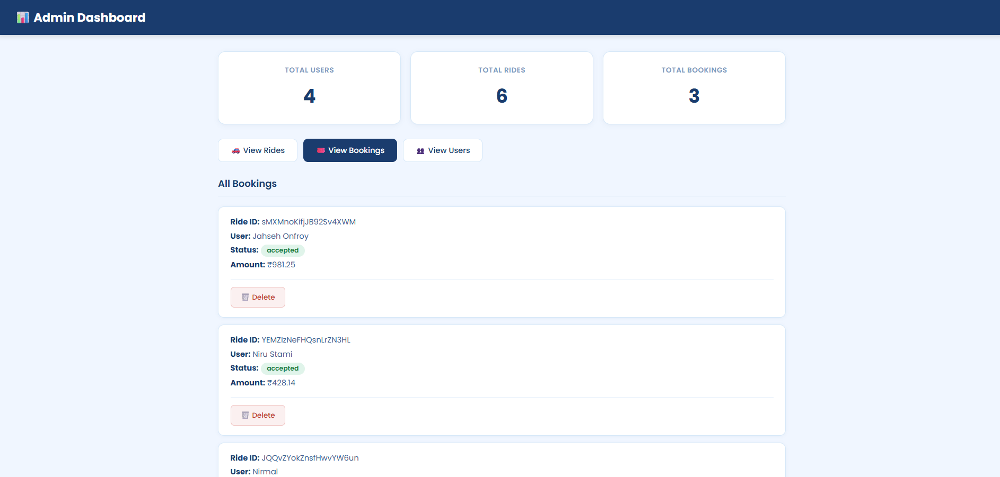

# MERN Stack Carpooling Web Application with Firebase Authentication

A full-stack carpooling platform that helps drivers publish available rides and passengers discover and request shared journeys.

## Overview

This application uses the MERN stack for its core web application and data management, with Firebase Authentication for user identity and sign-in.

- **MongoDB Atlas** stores application data.
- **Express.js and Node.js** provide the backend REST API.
- **React.js and Vite** power the frontend.
- **Firebase Authentication** supports email/password and Google sign-in.
- **Firebase Admin SDK** verifies Firebase ID tokens on protected backend routes.

## Features

- Email/password registration and login
- Google Sign-In
- Publish and discover rides
- Pickup and destination location suggestions
- Driving route visualization and distance calculation
- Ride fare calculation
- Ride booking and booking management
- User profiles
- Notifications
- Driver/passenger chat and messages
- Ratings and reviews
- Admin dashboard and management tools
- Image uploads through Cloudinary

## Technology Stack

| Area | Technologies |
|---|---|
| Frontend | React.js, Vite, JavaScript, CSS |
| Backend | Node.js, Express.js |
| Database | MongoDB Atlas, Mongoose |
| Authentication | Firebase Authentication |
| Backend token verification | Firebase Admin SDK |
| Maps | Leaflet, React Leaflet |
| Location suggestions | OpenCage API |
| Route and distance services | GraphHopper API |
| Image uploads | Cloudinary |
| HTTP requests | Axios, Fetch API |

## Architecture

```text
React + Vite frontend
        |
        | Firebase ID token
        v
Node.js + Express REST API
        |
        +---- Firebase Admin SDK
        |       Verifies ID tokens
        |
        +---- Mongoose
        |       |
        |       v
        |    MongoDB Atlas
        |    Users, rides, bookings,
        |    chats, messages, reviews,
        |    notifications
        |
        +---- OpenCage API
        +---- GraphHopper API

React frontend ---- Cloudinary (unsigned image upload)
```

Firebase Authentication handles registration and sign-in. MongoDB stores the application's user profiles and carpooling data. A user's MongoDB profile is associated with their Firebase UID.

## Project Structure

```text
Carpooling/
├── carpool-frontend/
│   ├── public/
│   ├── src/
│   │   ├── firebase/
│   │   ├── services/
│   │   ├── components/
│   │   └── pages/
│   ├── .env.example
│   └── package.json
├── carpool-backend/
│   ├── config/
│   ├── middleware/
│   ├── models/
│   ├── routes/
│   ├── .env.example
│   └── package.json
├── docs/
│   └── screenshots/
├── .gitignore
└── README.md
```

## Prerequisites

Install:

- [Node.js](https://nodejs.org/) and npm
- [Git](https://git-scm.com/)
- A MongoDB Atlas cluster and database user
- A Firebase project with Authentication providers configured
- An OpenCage API key
- A GraphHopper API key
- A Cloudinary account and unsigned upload preset

## Run Locally

### 1. Clone the repository

```bash
git clone https://github.com/NirmalThirumal/Carpooling-Web-Application.git
cd Carpooling-Web-Application
```

### 2. Configure the backend

Open a terminal:

```bash
cd carpool-backend
npm install
```

Create a local `.env` file by copying `.env.example`, then fill in your own values.

```env
MONGODB_URI=mongodb+srv://<username>:<password>@<cluster-url>/<database-name>?retryWrites=true&w=majority
OPENCAGE_API_KEY=your_opencage_api_key
GRAPHHOPPER_API_KEY=your_graphhopper_api_key
ADMIN_EMAILS=admin@example.com
GOOGLE_APPLICATION_CREDENTIALS=D:/path/to/firebase-service-account.json
```

`GOOGLE_APPLICATION_CREDENTIALS` must point to a Firebase service-account JSON file available on your own computer. Obtain it from your Firebase project settings and keep it outside the repository. Never commit the JSON file.

Start the backend:

```bash
npm run dev
```

The backend listens on `http://localhost:5000`.

### 3. Configure the frontend

Open a second terminal from the project root:

```bash
cd carpool-frontend
npm install
```

Create a local `.env` file by copying `carpool-frontend/.env.example`, then add your Firebase web-app configuration and Cloudinary upload configuration.

```env
VITE_API_BASE_URL=http://localhost:5000

VITE_FIREBASE_API_KEY=your_firebase_web_api_key
VITE_FIREBASE_AUTH_DOMAIN=your-project.firebaseapp.com
VITE_FIREBASE_PROJECT_ID=your-project-id
VITE_FIREBASE_STORAGE_BUCKET=your-project.firebasestorage.app
VITE_FIREBASE_MESSAGING_SENDER_ID=your_sender_id
VITE_FIREBASE_APP_ID=your_firebase_app_id

VITE_CLOUDINARY_CLOUD_NAME=your_cloudinary_cloud_name
VITE_CLOUDINARY_UPLOAD_PRESET=your_unsigned_upload_preset
```

The Firebase web configuration and Cloudinary unsigned upload settings are used by the browser and are not private server secrets. Protect their use with appropriate Firebase authorized-domain/API restrictions and a carefully configured Cloudinary unsigned preset. Never put MongoDB credentials, Firebase service-account credentials, or private API keys in frontend variables.

Start the frontend:

```bash
npm run dev
```

Vite normally serves the application at `http://localhost:5173`.

## Environment Variables

### Backend (`carpool-backend/.env`)

| Variable | Purpose |
|---|---|
| `MONGODB_URI` | MongoDB Atlas connection string |
| `GOOGLE_APPLICATION_CREDENTIALS` | Local path to Firebase Admin service-account JSON |
| `OPENCAGE_API_KEY` | OpenCage location suggestion API key |
| `GRAPHHOPPER_API_KEY` | GraphHopper route and distance API key |
| `ADMIN_EMAILS` | Comma-separated email addresses permitted to access admin routes |

### Frontend (`carpool-frontend/.env`)

| Variable | Purpose |
|---|---|
| `VITE_API_BASE_URL` | Base URL of the Express backend |
| `VITE_FIREBASE_API_KEY` | Firebase web app API key |
| `VITE_FIREBASE_AUTH_DOMAIN` | Firebase Authentication domain |
| `VITE_FIREBASE_PROJECT_ID` | Firebase project ID |
| `VITE_FIREBASE_STORAGE_BUCKET` | Firebase storage bucket identifier |
| `VITE_FIREBASE_MESSAGING_SENDER_ID` | Firebase messaging sender ID |
| `VITE_FIREBASE_APP_ID` | Firebase web app ID |
| `VITE_CLOUDINARY_CLOUD_NAME` | Cloudinary cloud name |
| `VITE_CLOUDINARY_UPLOAD_PRESET` | Cloudinary unsigned upload preset name |

Restart the Vite development server after changing frontend environment variables.

## Screenshots

### Homepage


### Login


### Signup


### Add Ride


### Ride Details


### Booking


### Admin Dashboard


## Security Notes

- Keep `.env` files and Firebase service-account JSON files out of version control.
- Use Firebase Authentication and verify ID tokens on protected backend endpoints.
- Apply least-privilege access rules to MongoDB Atlas network access and database users.
- Restrict the Firebase browser API key to the application's authorized domains and required APIs where supported.
- Configure the Cloudinary unsigned upload preset with appropriate upload limits and allowed formats.
- Frontend variables prefixed with `VITE_` are bundled into client-side code; do not store private credentials in them.

## Author

**Nirmal T**

B.Tech Computer Science Engineering
[GitHub Profile](https://github.com/NirmalThirumal)

## Repository

[Carpooling Web Application](https://github.com/NirmalThirumal/Carpooling-Web-Application)
